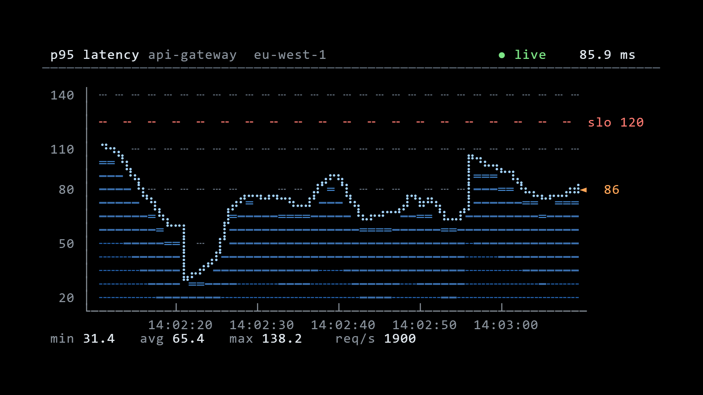

<table align="center">
  <tr>
    <td width="55%">
      <h3>Olá, eu sou o Rikelmy 👋</h3>
      

        <b>Data Analyst & Software Engineering Student</b> 
        Focado em análise de dados, pipelines em Python, SQL, automações e desenvolvimento backend.
      

      

        
        
      

    </td>
    <td width="45%" align="center">
      
    </td>
  </tr>
</table>

---

### 🛠️ Stack & Ferramentas

  
  
  
  
  
  
  

---

### 📊 Métricas & Atividade

  
  

  

